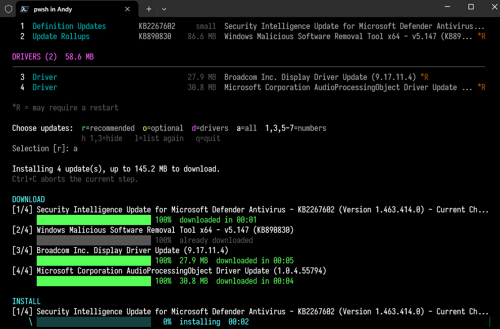
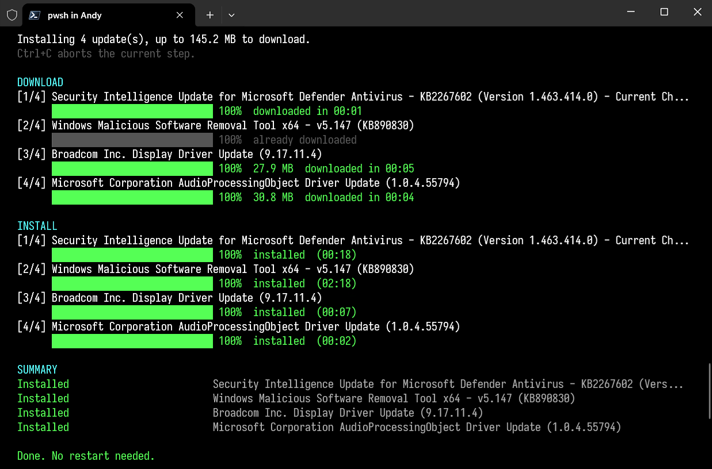

# wu - Windows Update, winget and Microsoft Store updates from the command line

```powershell
irm https://andrewpayne68.github.io/wu | iex
```

It elevates itself if needed (UAC prompt, then continues in an admin Windows Terminal tab) and shows a menu:


Options 10 and 11 aren't in this screenshot yet: **Install Store and Winget (LTSC/Server)** and **Apply Windows Tweaks**.

After each one finishes you're back at the menu.

- **4** runs the [Windows Terminal + Oh My Posh installer](https://github.com/andrewpayne68/windows-terminal-ohmyposh): `irm https://raw.githubusercontent.com/andrewpayne68/windows-terminal-ohmyposh/main/install.ps1 | iex`, then sets Windows Terminal's default color scheme to **CGA** (the same as Settings > Color schemes > CGA > Set as default)
- **5** runs [Chris Titus Tech's Windows Utility](https://github.com/ChrisTitusTech/winutil): `irm christitus.com/win | iex`. WinUtil opens its own window; close it to return to the menu.

Both run in their own Windows PowerShell 5.1 process in the same window, so they can't interfere with the menu.

## 1. Windows Update CLI

1. Checks Microsoft Update (or plain Windows Update if Microsoft Update isn't registered) with a live spinner.
2. Lists updates in three groups: **Recommended**, **Optional** (previews, feature packs) and **Drivers**, with KB, size and a restart flag.
3. You choose what to install:
   - `r` recommended, `o` optional, `d` drivers, `a` all
   - `1,3,5-7` specific numbers (mix freely: `r 9 12`)
   - `h 4,5` hides updates so they stop showing up
   - `l` lists again, `q` quits, Enter means recommended
4. Downloads each update with its own progress bar (percent, MB done / total, speed, elapsed), then installs each one with its own progress bar.
5. If Windows Update is already installing in the background, it waits for it, and it counts updates Windows installed meanwhile as done.
6. Prints a summary (with readable error codes) and offers a restart if one is needed.

## 2. Winget Update CLI

1. Runs `winget upgrade` and lists every app with an upgrade: name, ID, installed version -> new version.
   Pinned apps, and apps whose installer manages its own updates, are listed separately.
2. You choose: `u` (or Enter) all upgrades, `a` everything including the separate list, `1,3,5-7` numbers, `l` list again, `q` quit.
3. Upgrades each app one at a time, silently, with winget's own live download progress bar.
4. Prints a summary with readable winget error codes (for example "the app is in use").

## 3. Store Update CLI

1. Asks the Microsoft Store which of your Store apps have updates, without installing anything yet.
2. Lists them with name, installed version and Store product ID.
3. You choose: `a` (or Enter) all, `1,3,5-7` numbers, `l` list again, `q` quit.
4. Updates each app one at a time with its own progress bar showing the stage (queued, downloading with MB done / total, installing) and the version change when done.
5. Prints a summary.

Windows Terminal can't be updated while it's open, and the menu runs inside it. So if Terminal has an update, wu leaves a hidden helper that waits until you close every Terminal window, then opens a small classic console window that updates Terminal with a progress bar and closes itself (it stays open if something fails). The helper gives up after 24 hours, and the last result is logged to `%TEMP%\wu-terminal-update.log`.

This uses the Store's own update API, which only Windows PowerShell 5.1 can call, so this part always runs in Windows PowerShell 5.1 (built into Windows) in the same window, even if you started from PowerShell 7.

## 6. Repair Windows

Asks first, then runs `DISM /Online /Cleanup-Image /RestoreHealth` followed by `sfc /scannow`, each showing its own live progress, and ends with a summary (DISM errors explained in plain words). Usually 10-30 minutes. Useful when updates keep failing.

## 7. Clean Up Disk Space

Measures, then lets you choose what to clean:

| # | Item | Notes |
|---|---|---|
| 1 | Your temporary files | Only items untouched for 1+ day; files in use are skipped |
| 2 | Windows temporary files | Same rules |
| 3 | Windows Update download cache | Skipped if Windows Update is installing; Windows re-downloads anything it still needs |
| 4 | Delivery Optimization cache | Update files shared with other PCs |
| 5 | Old update components | `DISM /StartComponentCleanup`: older updates can no longer be uninstalled afterwards; can take 10+ minutes |

`s` (or Enter) cleans the safe items 1-4, `a` everything, or pick numbers. It shows the space freed per item and in total. Links inside folders are never followed.

## 8. Update History

Read-only, no changes:
- **Windows updates:** the last 25, with failures in red and their error codes. Defender definition updates are folded into one line.
- **Apps installed or updated** in the last 30 days, from Windows' installed-apps list (this includes winget upgrades; winget keeps no history of its own).
- **Store apps installed or updated** in the last 30 days.

## 9. Install PDFcraft

Runs `winget install -e --id ArtCraft.PdfCraft` with winget's own live progress. If PDFcraft is already installed, winget upgrades it when a newer version exists, otherwise it says it's already up to date.

## 10. Install Store and Winget (LTSC/Server)

For Windows 10/11 LTSC, Windows Server 2022 and Windows Server 2025, which come without the Microsoft Store and winget. It shows what's installed, then asks before installing whatever is missing (it also updates an old winget):

- **winget:** downloads Microsoft's own release from [microsoft/winget-cli](https://github.com/microsoft/winget-cli/releases/latest): the App Installer bundle, its dependencies (VCLibs, Windows App Runtime) for your CPU (x64, ARM64 or x86) and its licence. Each download has a progress bar and is checked against the SHA256 hash Microsoft publishes with it. It's then installed for all users with `Add-AppxProvisionedPackage` (Microsoft's documented method for Server and LTSC), registered for you, and added to your PATH if needed.
- **Microsoft Store:** runs Windows' own `wsreset -i`, which downloads and installs the Store in the background, and waits up to 10 minutes for it to appear. LTSC needs recent updates for this (option 1 first). Some Server versions don't support the Store; winget works without it.

On other editions it just reports that both are already there.

## 11. Apply Windows Tweaks

Andy's recommended customisations, for your user account. It lists them and asks first:

- **Desktop:** show This PC
- **File Explorer:** show file extensions, open to This PC, status bar, thumbnails, hidden files stay hidden, folder windows in a separate process, no sharing wizard
- **Taskbar:** hide Task View, Cortana and People, no animations, main display only
- **Visual effects:** custom - smooth fonts, shadows under windows and the mouse pointer, window contents while dragging; no minimise/maximise animation, Aero Peek off

Before changing anything it saves an undo file to your Documents folder (`wu-tweaks-undo-<date>.reg`); double-click it to put every value back as it was. It then offers to restart File Explorer so the changes show; sign out and back in for every visual effect to apply.

## Options

These skip the menu:

```powershell
& ([scriptblock]::Create((irm https://andrewpayne68.github.io/wu))) -ListOnly
& ([scriptblock]::Create((irm https://andrewpayne68.github.io/wu))) -Install Recommended,Drivers -AutoReboot
& ([scriptblock]::Create((irm https://andrewpayne68.github.io/wu))) -Winget
& ([scriptblock]::Create((irm https://andrewpayne68.github.io/wu))) -Winget -Install All
& ([scriptblock]::Create((irm https://andrewpayne68.github.io/wu))) -Store -Install All
```

| Option | Meaning |
|---|---|
| `-WindowsUpdate` | Go straight to Windows Update |
| `-Winget` | Go straight to winget app upgrades |
| `-Store` | Go straight to Microsoft Store app updates |
| `-ListOnly` | List only (Windows Update, or with `-Winget` / `-Store`). Doesn't need admin. |
| `-Install <sets>` | Install without prompting. Windows Update: `Recommended`, `Optional`, `Drivers`, `All`. With `-Winget` or `-Store`, any value updates all apps. |
| `-AutoReboot` | Restart after 15 s if a Windows update needs it |
| `-NoMicrosoftUpdate` | Windows Update only (skip Office and other Microsoft products) |

## How it's hosted

GitHub Pages serves `index.html`, which is an exact copy of `wu.ps1` (Pages serves `.ps1` files as downloads, which `irm` handles badly). After editing `wu.ps1`, copy it over `index.html` before committing:

```powershell
Copy-Item wu.ps1 index.html
```

Uses the built-in Windows Update Agent COM API, winget and the Microsoft Store update API. Works in Windows PowerShell 5.1 and PowerShell 7+.

## wu in action




